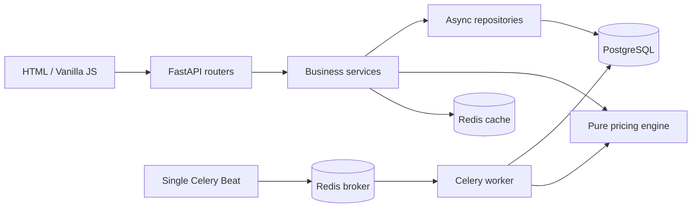
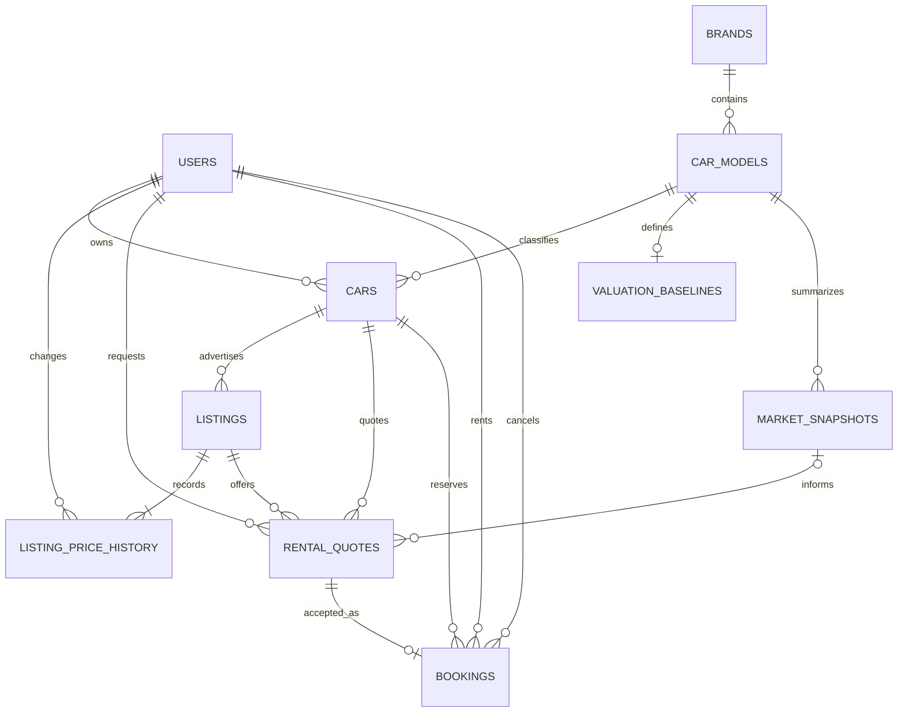

# Implementation architecture

AutoMetric is a modular monolith for an Armenian university diploma demonstration. FastAPI, Pydantic v2, SQLAlchemy 2 async, PostgreSQL, Redis, Celery, and NumPy implement the agreed architecture. HTML/Vanilla JS is served by the API; monetary values use AMD and business dates use Asia/Yerevan. All valuation data is synthetic.

## Components and data flow

- Routers validate HTTP input and delegate business behavior to services.
- Authentication reads the current account in its own short-lived session. Write services then own a fresh transaction and commit before a success response is returned.
- Repositories express explicit SQL queries and locking. Each concurrent operation owns its AsyncSession; relationship reads are eager and implicit ORM I/O is disabled.
- The pricing engine contains pure functions independent of the web framework and database. Monetary arithmetic uses Decimal and half-up rounding; statistical factors use NumPy and are converted to eight-decimal factors.
- PostgreSQL is authoritative for listings, quotes, bookings, price history, and market snapshots. Redis caches only public searches and transports Celery jobs.
- A worker computes an atomic batch of market snapshots every five minutes. One Beat scheduler dispatches jobs; a PostgreSQL transaction advisory lock skips overlapping jobs.
- Worker task entrypoints create/dispose a private async engine inside their event loop. API connections are never reused across worker loops.



## Inventory and authorization

Physical cars are separate from commercial listings. A globally unique VIN prevents duplicate physical inventory. One active listing per car is enforced by a partial unique index. Model, year, VIN, and owner are immutable after creation; owners/admins may edit other fields when no confirmed rental remains unfinished.

Public registration creates users. Users sell owned cars; dealers/admins rent and sell. Admins manage other owners' inventory without bypassing the requirement that rental inventory belong to a dealer/admin. Publishing and listing updates lock the owner before the car, serializing publication with role changes. Reservation and cancellation operations lock the car. Dealer demotion requires no active rental listing and no unfinished confirmed rental.

Listings transition active to archived and back subject to inventory rules; sale listings can become terminal sold. There are no hard-delete, ownership-transfer, payment, or sale-checkout endpoints. Price mutations and their history records commit together. Public responses hide VINs, emails, and password hashes.

JWT access tokens use a fixed HS256 algorithm, issuer/audience/expiry validation, and 30-minute lifetime. Passwords use Argon2. Tokens stay in browser memory and require login after refresh/expiration. Admin accounts are bootstrapped by CLI; the role endpoint only assigns user/dealer.

## Overlap-safe reservation transaction

Dates are inclusive. January 1–3 occupies three dates; the next booking may begin January 4. Rentals last 1–90 days, start no earlier than today, and end within 365 days of today.

1. Authenticate and find the renter's immutable quote.
2. Begin the service transaction and lock the physical car with SELECT FOR UPDATE.
3. Return an existing booking for an already accepted quote, including retries after quote expiration or cancellation.
4. Validate unexpired quote, active rental listing, current dates, active owner, and non-self-rental.
5. Check confirmed booking overlap in PostgreSQL.
6. Insert the booking with exactly the quote's car/renter/dates and commit.

Quotes freeze prices for ten minutes and do not reserve dates. Listing rate changes do not reprice valid quotes. Quotes are immutable through the API. A unique quote FK prevents duplicate acceptance; the composite quote FK prevents altered booking terms.

The generated `daterange(start_date,end_date,'[]')` canonicalizes inclusive dates correctly. The partial `EXCLUDE USING gist (car_id WITH =, period WITH &&) WHERE (status='confirmed')` constraint rejects competing writes, including writers bypassing application locks. The btree_gist extension supplies UUID equality support. Only the named exclusion violation maps to booking_overlap; unrelated database failures are not mislabeled.

Renter, owning dealer, or admin may cancel before the start date. Cancellation locks the car, re-reads the booking, and changes status atomically. Cancelled intervals stop blocking. Completed/in-progress phases are computed from dates; persisted booking status is confirmed/cancelled. Rental archive/specification changes use the same car lock and reject unfinished reservations.

## Search, cache, and failure behavior

Filters cover brand/model, year and price ranges, maximum mileage, fuel, and listing type. SQLAlchemy expressions bind filter values; ordering uses a fixed allowlist. Sort modes are newest, price_asc, price_desc, year_desc, and mileage_asc. Price ordering requires listing type because sale amounts and daily rental rates use different units.

Offset pages default to 20, limit at 100, and cap offset at 10,000. Cursor pages use signed filter-bound cursors containing the last sort value and listing UUID. Every sort has a UUID tie-breaker. Edits during traversal can move records; cursors are not database snapshots.

Public query results use `catalog:v1:{generation}:{query_hash}` with 60-second TTL. Inventory commits increment the generation; in-flight fills write only their original generation. Failed invalidation is bounded by TTL. Redis failures fall back to PostgreSQL. Availability, private inventory, quotes, bookings, and authentication are never cached.

Readiness requires a reachable migrated database. Redis loss marks readiness degraded while keeping API operation available. Market snapshots older than ten minutes use neutral pricing adjustments. Statistics freshness describes age; sale calibration additionally requires a matching baseline version and at least five samples.

Market recalculation uses REPEATABLE READ, a transaction advisory lock, and one commit for the batch. It retries bounded transient failures. Rental occupancy measures confirmed car-days for active model inventory over today through today+29. Sale calibration uses recent active asking prices, not completed sale transactions. Full formulas are in [valuation_methodology.md](valuation_methodology.md).

## Directory tree

Generated from project source; environment files, dependency caches, bytecode, and Git internals are omitted.

```text
coursework/
├── .github/
│   └── workflows/
│       └── ci.yml
├── alembic/
│   ├── versions/
│   │   ├── 0001_identity_and_inventory.py
│   │   ├── 0002_pricing_and_market_snapshots.py
│   │   ├── 0003_booking_constraints.py
│   │   └── 0004_strict_nullable_checks.py
│   ├── env.py
│   └── script.py.mako
├── app/
│   ├── api/
│   │   ├── routes/
│   │   │   ├── __init__.py
│   │   │   ├── admin.py
│   │   │   ├── analytics.py
│   │   │   ├── auth.py
│   │   │   ├── bookings.py
│   │   │   ├── cars.py
│   │   │   ├── health.py
│   │   │   ├── listings.py
│   │   │   ├── quotes.py
│   │   │   ├── reference.py
│   │   │   ├── users.py
│   │   │   └── valuations.py
│   │   ├── __init__.py
│   │   ├── dependencies.py
│   │   └── router.py
│   ├── core/
│   │   ├── __init__.py
│   │   ├── clock.py
│   │   ├── config.py
│   │   ├── database.py
│   │   ├── exceptions.py
│   │   ├── logging.py
│   │   ├── redis.py
│   │   └── security.py
│   ├── models/
│   │   ├── __init__.py
│   │   ├── base.py
│   │   ├── booking.py
│   │   ├── brand.py
│   │   ├── car.py
│   │   ├── car_model.py
│   │   ├── enums.py
│   │   ├── listing.py
│   │   ├── market_snapshot.py
│   │   ├── price_history.py
│   │   ├── rental_quote.py
│   │   ├── user.py
│   │   └── valuation_baseline.py
│   ├── pricing_engine/
│   │   ├── __init__.py
│   │   ├── depreciation.py
│   │   ├── parameters.py
│   │   ├── rental.py
│   │   ├── statistics.py
│   │   ├── types.py
│   │   └── valuation.py
│   ├── repositories/
│   │   ├── __init__.py
│   │   ├── analytics.py
│   │   ├── bookings.py
│   │   ├── inventory.py
│   │   ├── search.py
│   │   └── users.py
│   ├── schemas/
│   │   ├── __init__.py
│   │   ├── analytics.py
│   │   ├── auth.py
│   │   ├── booking.py
│   │   ├── car.py
│   │   ├── common.py
│   │   ├── health.py
│   │   ├── listing.py
│   │   ├── quote.py
│   │   ├── reference.py
│   │   ├── user.py
│   │   └── valuation.py
│   ├── services/
│   │   ├── __init__.py
│   │   ├── analytics.py
│   │   ├── auth.py
│   │   ├── bookings.py
│   │   ├── cache.py
│   │   ├── inventory.py
│   │   ├── quotes.py
│   │   ├── search.py
│   │   ├── transactions.py
│   │   └── valuation.py
│   ├── tasks/
│   │   ├── __init__.py
│   │   ├── celery_app.py
│   │   └── market_statistics.py
│   ├── __init__.py
│   └── main.py
├── data/
│   └── demo_baselines.csv
├── docs/
│   ├── architecture.md
│   ├── defense_demo.md
│   ├── openapi.json
│   └── valuation_methodology.md
├── frontend/
│   ├── css/
│   │   └── styles.css
│   ├── js/
│   │   ├── api.js
│   │   ├── auth.js
│   │   ├── booking.js
│   │   ├── catalog.js
│   │   ├── insights.js
│   │   └── valuation.js
│   └── index.html
├── scripts/
│   ├── __init__.py
│   ├── create_admin.py
│   ├── evaluate_valuation.py
│   ├── init_env.py
│   └── seed_demo.py
├── tests/
│   ├── integration/
│   │   ├── test_auth_and_permissions.py
│   │   ├── test_booking_concurrency.py
│   │   ├── test_booking_constraints.py
│   │   ├── test_catalog_search.py
│   │   ├── test_inventory_lifecycle.py
│   │   ├── test_market_statistics.py
│   │   ├── test_price_history.py
│   │   ├── test_quotes_and_cancellation.py
│   │   └── test_search_cache.py
│   ├── smoke/
│   │   └── test_demo_flow.py
│   ├── unit/
│   │   ├── test_rental_pricing.py
│   │   ├── test_search_cursor.py
│   │   └── test_valuation.py
│   ├── __init__.py
│   ├── conftest.py
│   └── factories.py
├── .dockerignore
├── .env.example
├── .gitignore
├── Dockerfile
├── Makefile
├── README.md
├── alembic.ini
├── docker-compose.yml
├── pyproject.toml
└── uv.lock
```

## Complete relational schema

UUID primary keys are generated in Python. Creation timestamps default to now(); updated_at is maintained on writes. All foreign keys restrict deletion. Monetary columns are whole-AMD NUMERIC(14,0). Nullable columns are marked yes. Database enum values follow the corresponding enums in `app/models/enums.py`.

### `brands`

| Column | PostgreSQL type | Nullable | Default / generated |
|---|---|---|---|
| `id (PK)` | `UUID` | no | application UUID |
| `name` | `VARCHAR(80)` | no |  |
| `slug` | `VARCHAR(100)` | no |  |

- UNIQUE `(slug)`.

```sql
CREATE UNIQUE INDEX uq_brands_name_lower ON brands (lower(name));
```

### `users`

| Column | PostgreSQL type | Nullable | Default / generated |
|---|---|---|---|
| `id (PK)` | `UUID` | no | application UUID |
| `email` | `VARCHAR(254)` | no |  |
| `password_hash` | `TEXT` | no |  |
| `full_name` | `VARCHAR(100)` | no |  |
| `role` | `role` | no | user |
| `is_active` | `BOOLEAN` | no | true |
| `created_at` | `TIMESTAMP WITH TIME ZONE` | no | now() |
| `updated_at` | `TIMESTAMP WITH TIME ZONE` | no | now() |

```sql
CREATE UNIQUE INDEX uq_users_email_lower ON users (lower(email));
```

### `car_models`

| Column | PostgreSQL type | Nullable | Default / generated |
|---|---|---|---|
| `id (PK)` | `UUID` | no | application UUID |
| `brand_id` | `UUID` | no |  |
| `name` | `VARCHAR(100)` | no |  |
| `slug` | `VARCHAR(120)` | no |  |

- FK `(brand_id)` → `(brands.id)`; ON DELETE RESTRICT.
- UNIQUE `(brand_id, slug)`.

```sql
CREATE UNIQUE INDEX uq_car_models_brand_name ON car_models (brand_id, lower(name));
```

### `cars`

| Column | PostgreSQL type | Nullable | Default / generated |
|---|---|---|---|
| `id (PK)` | `UUID` | no | application UUID |
| `owner_id` | `UUID` | no |  |
| `model_id` | `UUID` | no |  |
| `vin` | `VARCHAR(17)` | no |  |
| `year` | `SMALLINT` | no |  |
| `mileage_km` | `INTEGER` | no |  |
| `fuel_type` | `fueltype` | no |  |
| `transmission` | `transmission` | no |  |
| `condition` | `condition` | no |  |
| `color` | `VARCHAR(40)` | yes |  |
| `image_url` | `VARCHAR(255)` | yes | Public local image path |
| `created_at` | `TIMESTAMP WITH TIME ZONE` | no | now() |
| `updated_at` | `TIMESTAMP WITH TIME ZONE` | no | now() |

- CHECK `mileage_km >= 0`.
- CHECK `vin ~ '^[A-HJ-NPR-Z0-9]{17}$'`.
- CHECK `year BETWEEN 1900 AND 2100`.
- FK `(model_id)` → `(car_models.id)`; ON DELETE RESTRICT.
- FK `(owner_id)` → `(users.id)`; ON DELETE RESTRICT.
- UNIQUE `(vin)`.

```sql
CREATE INDEX ix_cars_fuel_year ON cars (fuel_type, year, id);
CREATE INDEX ix_cars_model_year_mileage ON cars (model_id, year, mileage_km, id);
CREATE INDEX ix_cars_owner_created ON cars (owner_id, created_at DESC, id DESC);
```

### `market_snapshots`

| Column | PostgreSQL type | Nullable | Default / generated |
|---|---|---|---|
| `id (PK)` | `UUID` | no | application UUID |
| `model_id` | `UUID` | no |  |
| `listing_type` | `listingtype` | no |  |
| `as_of` | `TIMESTAMP WITH TIME ZONE` | no |  |
| `window_start` | `DATE` | no |  |
| `window_end` | `DATE` | no |  |
| `listing_count` | `INTEGER` | no |  |
| `sample_count` | `INTEGER` | no |  |
| `median_price_amd` | `NUMERIC(14, 0)` | yes |  |
| `p25_price_amd` | `NUMERIC(14, 0)` | yes |  |
| `p75_price_amd` | `NUMERIC(14, 0)` | yes |  |
| `sale_market_multiplier` | `NUMERIC(8, 5)` | yes |  |
| `residual_log_mad` | `NUMERIC(10, 6)` | yes |  |
| `baseline_version` | `VARCHAR(32)` | yes |  |
| `occupied_car_days` | `INTEGER` | yes |  |
| `available_car_days` | `INTEGER` | yes |  |
| `occupancy_ratio` | `NUMERIC(7, 6)` | yes |  |

- CHECK `(occupied_car_days IS NULL AND available_car_days IS NULL) OR (occupied_car_days IS NOT NULL AND available_car_days IS NOT NULL AND occupied_car_days >= 0 AND available_car_days >= occupied_car_days)`.
- CHECK `sample_count >= 0 AND listing_count >= sample_count`.
- CHECK `residual_log_mad IS NULL OR residual_log_mad >= 0`.
- CHECK `(listing_type = 'sale' AND occupied_car_days IS NULL AND available_car_days IS NULL AND occupancy_ratio IS NULL) OR (listing_type = 'rent' AND sale_market_multiplier IS NULL AND residual_log_mad IS NULL AND baseline_version IS NULL)`.
- CHECK `occupancy_ratio IS NULL OR occupancy_ratio BETWEEN 0 AND 1`.
- CHECK `(median_price_amd IS NULL AND p25_price_amd IS NULL AND p75_price_amd IS NULL) OR (median_price_amd IS NOT NULL AND p25_price_amd IS NOT NULL AND p75_price_amd IS NOT NULL AND p25_price_amd > 0 AND p25_price_amd <= median_price_amd AND median_price_amd <= p75_price_amd)`.
- CHECK `sale_market_multiplier IS NULL OR sale_market_multiplier BETWEEN .85 AND 1.15`.
- CHECK `window_end >= window_start`.
- FK `(model_id)` → `(car_models.id)`; ON DELETE RESTRICT.
- UNIQUE `(model_id, listing_type, as_of)`.

```sql
CREATE INDEX ix_snapshots_model_type_asof ON market_snapshots (model_id, listing_type, as_of DESC);
```

### `valuation_baselines`

| Column | PostgreSQL type | Nullable | Default / generated |
|---|---|---|---|
| `model_id (PK)` | `UUID` | no |  |
| `base_price_amd` | `NUMERIC(14, 0)` | no |  |
| `source` | `VARCHAR(40)` | no |  |
| `version` | `VARCHAR(32)` | no |  |
| `updated_at` | `TIMESTAMP WITH TIME ZONE` | no | now() |

- CHECK `base_price_amd > 0`.
- FK `(model_id)` → `(car_models.id)`; ON DELETE RESTRICT.

### `listings`

| Column | PostgreSQL type | Nullable | Default / generated |
|---|---|---|---|
| `id (PK)` | `UUID` | no | application UUID |
| `car_id` | `UUID` | no |  |
| `listing_type` | `listingtype` | no |  |
| `status` | `listingstatus` | no | active |
| `title` | `VARCHAR(150)` | no |  |
| `description` | `TEXT` | no |  |
| `city` | `VARCHAR(100)` | no |  |
| `price_amd` | `NUMERIC(14, 0)` | no |  |
| `price_updated_at` | `TIMESTAMP WITH TIME ZONE` | no | now() |
| `created_at` | `TIMESTAMP WITH TIME ZONE` | no | now() |
| `updated_at` | `TIMESTAMP WITH TIME ZONE` | no | now() |

- CHECK `price_amd > 0`.
- CHECK `status <> 'sold' OR listing_type = 'sale'`.
- FK `(car_id)` → `(cars.id)`; ON DELETE RESTRICT.
- UNIQUE `(id, car_id, listing_type)`.

```sql
CREATE INDEX ix_listings_car_id ON listings (car_id);
CREATE INDEX ix_listings_type_created ON listings (listing_type, created_at DESC, id DESC) WHERE status = 'active';
CREATE INDEX ix_listings_type_price ON listings (listing_type, price_amd, id) WHERE status = 'active';
CREATE UNIQUE INDEX uq_one_active_listing_per_car ON listings (car_id) WHERE status = 'active';
```

### `listing_price_history`

| Column | PostgreSQL type | Nullable | Default / generated |
|---|---|---|---|
| `id (PK)` | `UUID` | no | application UUID |
| `listing_id` | `UUID` | no |  |
| `old_price_amd` | `NUMERIC(14, 0)` | yes |  |
| `new_price_amd` | `NUMERIC(14, 0)` | no |  |
| `changed_by` | `UUID` | no |  |
| `reason` | `VARCHAR(32)` | no |  |
| `changed_at` | `TIMESTAMP WITH TIME ZONE` | no | now() |

- CHECK `(reason = 'initial' AND old_price_amd IS NULL) OR (reason IN ('owner_update', 'admin_update') AND old_price_amd IS NOT NULL AND old_price_amd > 0 AND old_price_amd <> new_price_amd)`.
- CHECK `new_price_amd > 0`.
- FK `(changed_by)` → `(users.id)`; ON DELETE RESTRICT.
- FK `(listing_id)` → `(listings.id)`; ON DELETE RESTRICT.

```sql
CREATE INDEX ix_history_listing_changed ON listing_price_history (listing_id, changed_at DESC, id DESC);
```

### `rental_quotes`

| Column | PostgreSQL type | Nullable | Default / generated |
|---|---|---|---|
| `id (PK)` | `UUID` | no | application UUID |
| `listing_id` | `UUID` | no |  |
| `car_id` | `UUID` | no |  |
| `listing_type` | `listingtype` | no |  |
| `renter_id` | `UUID` | no |  |
| `start_date` | `DATE` | no |  |
| `end_date` | `DATE` | no |  |
| `days` | `SMALLINT` | no | end_date - start_date + 1 |
| `base_daily_rate_amd` | `NUMERIC(14, 0)` | no |  |
| `total_price_amd` | `NUMERIC(14, 0)` | no |  |
| `market_snapshot_id` | `UUID` | yes |  |
| `pricing_version` | `VARCHAR(32)` | no |  |
| `pricing_breakdown` | `JSONB` | no |  |
| `created_at` | `TIMESTAMP WITH TIME ZONE` | no | now() |
| `expires_at` | `TIMESTAMP WITH TIME ZONE` | no |  |

- CHECK `base_daily_rate_amd > 0 AND total_price_amd > 0`.
- CHECK `days BETWEEN 1 AND 90`.
- CHECK `expires_at > created_at`.
- CHECK `listing_type = 'rent'`.
- FK `(listing_id, car_id, listing_type)` → `(listings.id, listings.car_id, listings.listing_type)`; ON DELETE RESTRICT.
- FK `(market_snapshot_id)` → `(market_snapshots.id)`; ON DELETE RESTRICT.
- FK `(renter_id)` → `(users.id)`; ON DELETE RESTRICT.
- UNIQUE `(id, car_id, renter_id, start_date, end_date)`.

```sql
CREATE INDEX ix_quotes_renter_created ON rental_quotes (renter_id, created_at DESC);
```

### `bookings`

| Column | PostgreSQL type | Nullable | Default / generated |
|---|---|---|---|
| `id (PK)` | `UUID` | no | application UUID |
| `quote_id` | `UUID` | no |  |
| `car_id` | `UUID` | no |  |
| `renter_id` | `UUID` | no |  |
| `start_date` | `DATE` | no |  |
| `end_date` | `DATE` | no |  |
| `period` | `DATERANGE` | no | daterange(start_date, end_date, '[]') |
| `status` | `bookingstatus` | no | confirmed |
| `created_at` | `TIMESTAMP WITH TIME ZONE` | no | now() |
| `cancelled_at` | `TIMESTAMP WITH TIME ZONE` | yes |  |
| `cancelled_by` | `UUID` | yes |  |
| `cancellation_reason` | `VARCHAR(500)` | yes |  |

- EXCLUDE USING gist `(car_id WITH =, period WITH &&)` WHERE `status='confirmed'`.
- CHECK `end_date >= start_date AND end_date - start_date + 1 <= 90`.
- CHECK `(status = 'confirmed' AND cancelled_at IS NULL AND cancelled_by IS NULL AND cancellation_reason IS NULL) OR (status = 'cancelled' AND cancelled_at IS NOT NULL AND cancelled_by IS NOT NULL)`.
- FK `(cancelled_by)` → `(users.id)`; ON DELETE RESTRICT.
- FK `(car_id)` → `(cars.id)`; ON DELETE RESTRICT.
- FK `(quote_id, car_id, renter_id, start_date, end_date)` → `(rental_quotes.id, rental_quotes.car_id, rental_quotes.renter_id, rental_quotes.start_date, rental_quotes.end_date)`; ON DELETE RESTRICT.
- FK `(renter_id)` → `(users.id)`; ON DELETE RESTRICT.
- UNIQUE `(quote_id)`.

```sql
CREATE INDEX ix_bookings_car_status_end ON bookings (car_id, status, end_date);
CREATE INDEX ix_bookings_renter_created ON bookings (renter_id, created_at DESC, id DESC);
```

## Entity relationships



## REST endpoints and schemas

The exact request properties, constraints, query parameters, enums, and response properties are in the checked-in [OpenAPI contract](openapi.json). `/docs` renders it interactively, and `/openapi.json` exposes the running contract. Schemas live in `app/schemas`. All business routes begin with `/api/v1`.

Money is a fixed-point decimal string; dates are YYYY-MM-DD, timestamps ISO 8601, and identifiers UUID strings. Mutation bodies reject unknown fields. PATCH excludes omitted fields and rejects explicit nulls/empty updates. Errors use `{error:{code,message,details}}`; 401 means unauthenticated, 403 forbidden role, 404 inaccessible/missing object, 409 business conflict, and 422 invalid input.

Page responses contain items, limit, offset, total, and next_cursor. Offset pages return counts; cursor pages return total=null. Login uses OAuth2 form fields username=email and password. Registration always creates a user. HTML/static routes are `/` and `/static/{path}`; framework documentation is at `/docs` and `/redoc`.

| Method | Endpoint | Body schema | Success response |
|---|---|---|---|
| POST | `/api/v1/auth/register` | RegisterRequest | 201 UserRead |
| POST | `/api/v1/auth/token` | Body_issue_token_api_v1_auth_token_post | 200 TokenRead |
| GET | `/api/v1/users/me` | — | 200 UserRead |
| GET | `/api/v1/brands` | — | 200 BrandRead[] |
| GET | `/api/v1/models` | — | 200 ModelRead[] |
| POST | `/api/v1/cars` | CarCreate | 201 CarPrivateRead |
| POST | `/api/v1/cars/{car_id}/image` | Multipart file (JPG/JPEG/PNG/WebP, ≤5 MiB) | 200 CarPrivateRead |
| GET | `/api/v1/me/cars` | — | 200 Page_CarPrivateRead_ |
| GET | `/api/v1/cars/{car_id}` | — | 200 CarPrivateRead |
| PATCH | `/api/v1/cars/{car_id}` | CarUpdate | 200 CarPrivateRead |
| GET | `/api/v1/listings` | — | 200 Page_ListingRead_ |
| POST | `/api/v1/listings` | ListingCreate | 201 ListingRead |
| GET | `/api/v1/me/listings` | — | 200 Page_ListingRead_ |
| GET | `/api/v1/listings/{listing_id}` | — | 200 ListingRead |
| PATCH | `/api/v1/listings/{listing_id}` | ListingUpdate | 200 ListingRead |
| GET | `/api/v1/listings/{listing_id}/price-history` | — | 200 Page_PriceHistoryRead_ |
| POST | `/api/v1/valuations/sale` | SaleValuationRequest | 200 SaleValuationRead |
| POST | `/api/v1/rental-quotes` | RentalQuoteCreate | 201 RentalQuoteRead |
| GET | `/api/v1/rental-quotes/{quote_id}` | — | 200 RentalQuoteRead |
| GET | `/api/v1/listings/{listing_id}/availability` | — | 200 AvailabilityRead |
| POST | `/api/v1/bookings` | BookingCreate | 201 BookingRead, 200 BookingRead (retry) |
| GET | `/api/v1/me/bookings` | — | 200 Page_BookingRead_ |
| GET | `/api/v1/me/rental-reservations` | — | 200 Page_BookingRead_ |
| GET | `/api/v1/bookings/{booking_id}` | — | 200 BookingRead |
| POST | `/api/v1/bookings/{booking_id}/cancel` | BookingCancel | 200 BookingRead |
| GET | `/api/v1/analytics/market` | — | 200 Page_MarketSnapshotRead_ |
| GET | `/api/v1/analytics/inventory` | — | 200 InventorySummary |
| GET | `/api/v1/admin/users` | — | 200 Page_UserRead_ |
| PATCH | `/api/v1/admin/users/{user_id}/role` | RoleUpdate | 200 UserRead |
| GET | `/api/v1/health/live` | — | 200 LiveRead |
| GET | `/api/v1/health/ready` | — | 200 HealthRead |

### Access rules

Public: registration/login, brands/models, active catalog/details/history, sale valuation, rental availability, health. Optional authentication allows owners/admins to read inactive listings. Authenticated: owned cars/listings, own quotes/bookings. Booking detail/cancellation additionally permit the owning dealer/admin. Dealer/admin: incoming rental reservations and analytics. Admin: user list and user/dealer role updates.

Dealers' inventory summaries cover their own cars; admins see platform totals. Market summaries are aggregated across the public market. Inventory counts are current; booking counts/value use confirmed bookings starting inside the selected date window. Rental availability exposes occupied intervals without renter identities.

## Milestones and validation

1. **Docker/database/auth:** locked dependencies, Compose, migrations, JWT/Argon2, role dependencies, readiness.
2. **Catalog/search:** car/listing lifecycle, filters, stable ordering, offset/cursor paging, price history.
3. **Safe rentals:** immutable quotes, car locks, GiST exclusion, idempotent acceptance, cancellations/calendar.
4. **Pricing/cache/tasks:** explainable formulas, neutral fallbacks, Redis search cache, atomic periodic statistics.
5. **Demo/tests/docs:** responsive HTML/JS, synthetic seed, Pytest integration/concurrency, CI, defense/evaluation materials.

Migrations order reference/inventory tables before pricing/quotes and then bookings because booking foreign keys depend on quote and snapshot tables. A fourth migration tightens nullable CHECK groups: PostgreSQL CHECK treats NULL as unknown, so valid groups explicitly require all-or-none values.

Unit tests cover monotonic depreciation/mileage effects, condition ordering, calibration shrinkage/clipping, heuristic ranges, duration thresholds, leap dates, rounding, and cursor signatures. Integration tests require a deliberately named separate test database and Redis /15; they test permissions, catalog lifecycle, price history, direct database constraint violations, twenty competing reservations, idempotent acceptance, cancellation, cached queries, stale snapshots, advisory locking, and a real Celery worker. CI runs this suite against PostgreSQL/Redis services. No SQLite substitutes are used for PostgreSQL behavior.

Bootstrap explicitly migrates and seeds before launching API/worker/Beat. Existing demo data is preserved. One Beat instance is supported. The deployment is intended for a local thesis defense; no production release or external publication is performed by bootstrap.

## Exact-model local photo dataset

The checked-in dataset has 36 unique real Commons photographs, three per supported model, stored as `<brand_slug>/<model_slug>_<n>.jpg`. `data/car_image_sources.json` records vetted source filenames, authors, and licenses. The explicit `scripts.fetch_car_images` command downloads standard cached image sizes, validates JPEG decoding/resolution/size/uniqueness, and creates the local checksum/credit manifest. Runtime and seed commands make no requests to external image providers.

`scripts.update_car_images` assigns only missing/project-managed images, joining cars through model and brand and rotating within each model in newest-listing order. It refuses mismatched fallbacks and preserves uploaded UUID URLs. Seeding invokes this same assignment. Bundled files are installed into existing Docker volumes before the transaction. A local credit gallery links each derivative to its photographer, original source, and CC BY-SA 4.0 license. New custom uploads continue to use the unchanged authenticated multipart endpoint.
